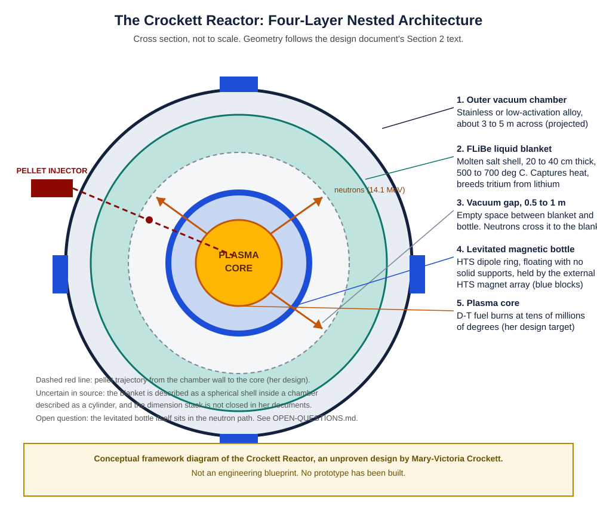

# The Crockett Reactor: An Open Source Fusion Framework

A wall-less fusion reactor architecture by Mary-Victoria Crockett, released open source under Operation ProleBlitz so that anyone can test it, critique it, improve it, or refute it.

## What this is, in plain language

Most fusion machines hold their fuel in a magnetic bottle that sits inside a solid metal wall, and the wall is where the design goes to die. Fusion neutrons slam into it, the metal goes brittle, and every few years the most expensive part of the plant has to be swapped out. Fuel is also fed in at the edge of the plasma, where it cools the reaction it is meant to feed, and stirs up the turbulence that breaks confinement.

The Crockett Reactor rearranges the machine to remove those failure points instead of patching them:

1. **The bottle floats.** The magnetic confinement bottle is a superconducting magnet levitated inside a larger vacuum chamber by a second, external magnet array. No supports touch it. There is no solid first wall in the neutron path.
2. **Fuel goes to the center.** Layered pellets with a timed ablative coating are fired at high speed straight to the magnetic axis, where the coating finishes vaporizing and the fuel releases at the hottest point. The author calls this inside-out ignition.
3. **The blanket sits far away.** Across a vacuum gap sits a shell of FLiBe, a molten salt of lithium and beryllium fluorides. It catches the neutron energy as heat for a turbine, and its lithium breeds new tritium fuel while its beryllium multiplies neutrons.

The author's names for the three problems this attacks are the Soggy Firewood problem (edge fueling), the Leaky Bottle problem (fueling-driven turbulence), and the Crumbling Cage problem (wall embrittlement). The full design, in her words, is in docs/full-design-document.md.

*Conceptual framework diagram of the Crockett Reactor, an unproven design by Mary-Victoria Crockett. Not an engineering blueprint. No prototype has been built.*

## Honest status box

Read this before anything else in the folder.

- **This is a theoretical framework. It is not established science.** No prototype has been built. No part of this design has been experimentally validated. Nothing here has been peer reviewed.
- **Every performance figure is the author's projection** from her design model: Q greater than 10, a tritium breeding ratio of about 2.01, a 500 MWth pilot making about 186 MWe, an LCOE of $28 to $34 per MWh. Projections are labeled as projections in the documents, and the ones that failed checking are corrected or flagged in the open, in FACT-CHECK-LOG.md.
- **Some load-bearing claims are open problems, not results.** The breeding ratio has no supporting calculation. The levitated magnet itself sits in the neutron path, so magnet embrittlement is unsolved. The dimension stack does not close. All of it is listed, item by item, in OPEN-QUESTIONS.md.
- **What is established physics here is established.** Levitated dipole confinement is real and demonstrated (LDX at MIT, RT-1 at the University of Tokyo, and OpenStar's Junior, which achieved fully levitated plasma in February 2026). The D-T energy split, the lithium breeding reactions, FLiBe chemistry, and the Part 30 regulatory pathway all check out, and the log shows the checking.
- **Two fact-check sweeps were run over this corpus before release**, plus a page by page triage of the schematics document. Thirteen errors were corrected in place, including a payback figure that was off by a factor of ten and a "world's first" claim that belonged to earlier experiments. Fifteen claim groups are flagged as unverified. The log hides nothing.
- **Patent status:** the documents say patent pending, but no filing is documented in the corpus, and the author's DOE proposal of September 30, 2026 states that no applications had yet been filed. This release is open source on purpose, filing or no filing. See the invitation below.

## Why open source

Energy is the fourth bottleneck. A society can teach people to grow food, print parts, and repair machines, and it still leaves them tenants if every watt is metered by someone else. Fusion is the one energy source that could break that arrangement for good, and its designs have sat inside institutions, companies, and patent portfolios for seventy years without arriving.

The author is an independent inventor with no lab, no team, and no money to defend a patent. Her reasoning, in her founding essay (docs/why-im-giving-it-away.md, October 2025), is that an idea this important should not wither on a shelf. So the design is given away, copyleft, with its errors corrected in public and its open problems labeled in public, on the theory that a design anyone can attack is worth more than a secret no one can test.

That is also the deal this release offers you. The honesty is not a disclaimer stapled to the work. It is the work.

## File map

- **README.md**: this file, the front door.
- **OPEN-QUESTIONS.md**: every novel, untested, or unresolved claim, with the test or calculation that would settle it. Start here if you want to help.
- **FACT-CHECK-LOG.md**: the schematics triage and both fact-check sweeps, with before and after text for every correction.
- **INVENTORY.md**: every source document in the author's fusion corpus, where it came from, and what became of it in this release, including the items held back and why.
- **docs/reactor-explainer.md**: the 14-slide explainer deck, converted to text. The plain language version.
- **docs/full-design-document.md**: the full technical design document (April 2026): architecture, pellet design, levitation, FLiBe blanket, closed-loop operation, economics, safety, and draft patent claim language. Sweep corrections and notes are in place.
- **docs/arpa-e-pitch.md**: the two-page pitch prepared for ARPA-E's fusion portfolio and CHADWICK program.
- **docs/doe-proposal-reactor-section.md**: Section 4 of the author's September 2026 DOE technology proposal, the reactor package, with the proposal's own status statement.
- **docs/why-im-giving-it-away.md**: the founding essay, October 2025.
- **docs/funding-paths.md**: a supporting research memo on funding programs, dated April 2026. Time-sensitive, labeled as such.
- **diagrams/**: four redrawn diagrams (SVG) with a README tracing every element to the source documents. The original diagram plates were illegible as rendered, white text on white, labels clipped and overlapping. The redraws show the concept at the level the documents support and mark uncertain elements as uncertain. Every diagram is captioned as a conceptual framework diagram of an unproven design. None is an engineering blueprint.

## The invitation

This design needs enemies of the friendly kind. If you know fusion, plasma physics, neutronics, superconducting magnets, molten salt chemistry, control systems, or power plant economics, your strongest move is not applause. It is a calculation.

The most valuable contributions, in rough order:

1. **A neutronics run at the breeding ratio.** Model the stated blanket and publish the number, whatever it is. Open question 1.
2. **A damage estimate for the levitated magnet.** Fluence, displacement damage, and what shielding or replacement strategy the numbers force. Open question 6.
3. **A levitation control simulation** that includes pellet injection as a disturbance. Open question 7.
4. **An ablation model** for the pellet along a realistic trajectory, with the timing tolerance stated. Open question 12.
5. **A dimension stack that closes.** One geometry, radius by radius. Open question 19.
6. **Sources for the flagged figures**, or better figures to replace them. FACT-CHECK-LOG.md lists all fifteen flagged groups.
7. **A refutation.** If a core claim fails, show the failure cleanly. A clean refutation is a contribution, and it will be kept in the log with credit, not buried.

How to contribute: open an issue for a question, a correction, or a calculation. Send pull requests for document fixes, new diagrams, or model files, with your sources cited so the next sweep can check them. Use discussions for design arguments. Corrections follow the house rule of this release: errors get fixed in place, the before and after go in FACT-CHECK-LOG.md, and nobody's name comes off their work.

Skeptics are explicitly welcome. So are students, hobbyists, and anyone who has ever wanted to run a fusion calculation and never had a design they were allowed to touch. Now you have one.

## License

Designs and any code: GPL-3.0-or-later. Writings and documents: CC BY-SA 4.0. This matches the license of the Operation ProleBlitz repository. Build on it, share alike, keep it free.

## Author

Mary-Victoria Crockett, independent inventor, Arkansas. Two hundred plus documented inventions across fusion, biomedical devices, protein folding, and materials. This framework is released as part of Operation ProleBlitz, an open source project building tools and audits for ordinary people.
