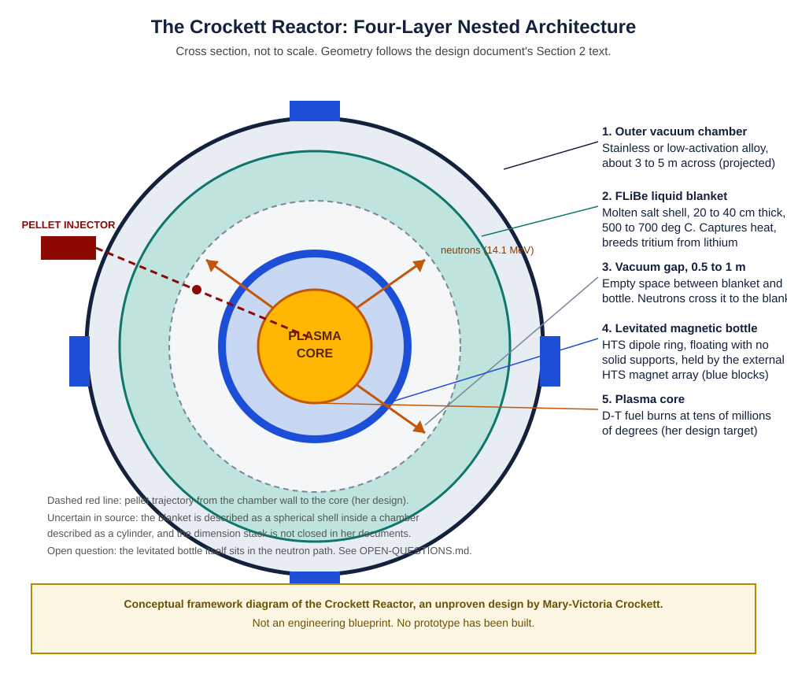
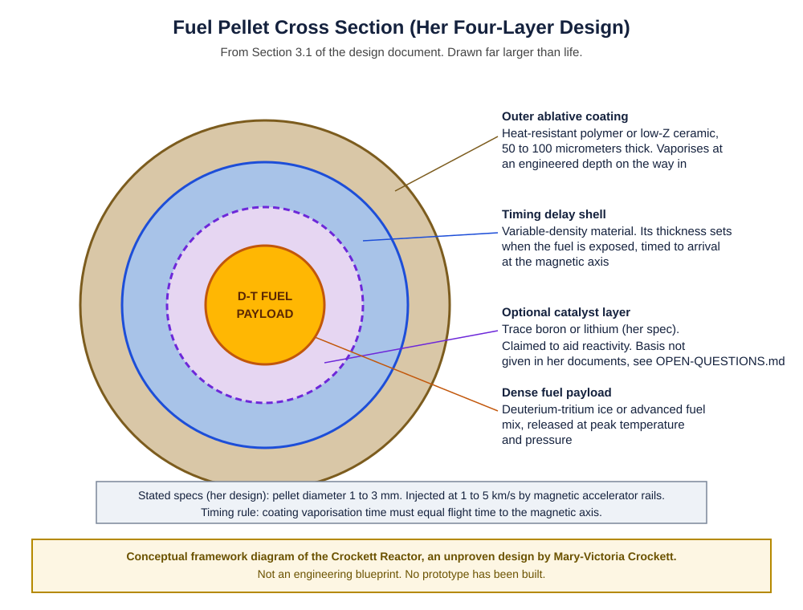
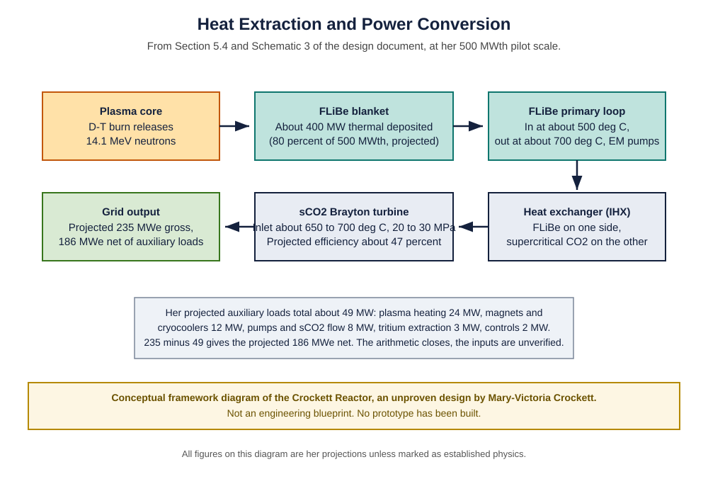
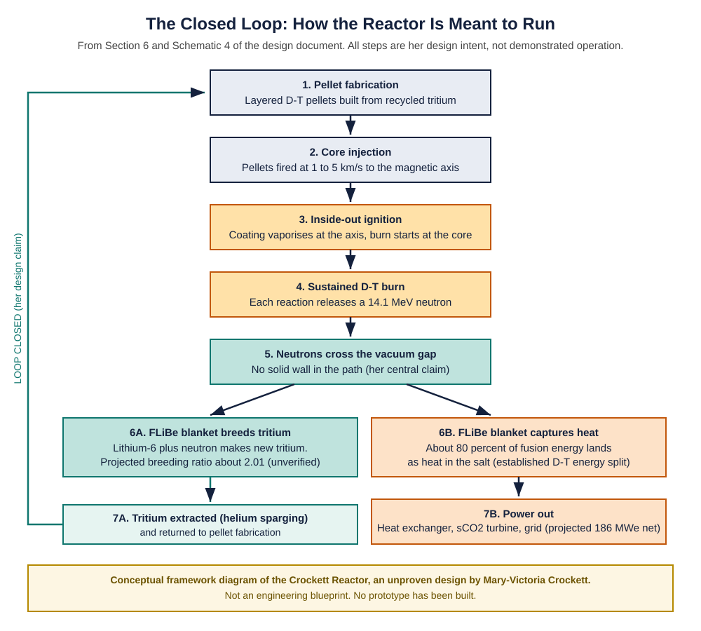

# The Crockett Reactor: Full Technical Schematics and Design Document

Source: "ARPA Nuclear Fusion Schematics," the full design document by Mary-Victoria Crockett, April 2026, converted from the PDF. The document exists in several identical copies in her Drive. The five drawn diagram plates at the front of the PDF were illegible as rendered (white on white text, clipped and overlapping labels) and are omitted here. They have been redrawn, see the diagrams folder and the embeds in this document. The inventor contact block and a submission note naming individual officials are omitted from the release copy. Everything else is her text, with formatting cleaned, tables rejoined across page breaks, and wording preserved.

Status: every performance figure in this document is the author's projection from her design model. Nothing in this document has been built or independently validated. See FACT-CHECK-LOG.md for the page by page triage verdicts and the sweep corrections.

---

**THE CROCKETT REACTOR**
**Full Technical Schematics & Design Document**
**A Novel Wall-Less Fusion Reactor Architecture**
Authored by: Mary-Victoria Crockett
Conceptual Architect | Independent Inventor
North Little Rock, Arkansas
April 2026

[Original diagram plates omitted. They were illegible as rendered and have been redrawn. See the diagrams folder. The plates covered: Part 1 Full System Overview, Part 2 Core Ignition System, Part 3 Levitation Mechanism, Part 4 FLiBe Blanket, Part 5 Full Integrated System.]



*Conceptual framework diagram of the Crockett Reactor, an unproven design by Mary-Victoria Crockett. Not an engineering blueprint. No prototype has been built.*

## 1. Executive Summary

The Crockett Reactor is a novel nuclear fusion architecture that eliminates the three fundamental bottlenecks that have prevented commercial fusion for 70 years. Rather than incrementally improving existing tokamak designs, this architecture removes the failure points entirely through three coordinated innovations.

Traditional fusion approaches fail on three fronts simultaneously: ignition requires massive external heating because fuel is introduced at the plasma edge rather than the core (the 'soggy firewood' problem); plasma instability caused by edge gas puffing creates turbulence that disrupts confinement (the 'leaky bottle' problem); and neutron bombardment embrittles solid reactor walls requiring costly replacement cycles that make indefinite runtime impossible (the 'crumbling cage' problem).

The Crockett Reactor solves all three architecturally:

- **Core Ignition System** — Multi-layered ablative fuel pellets injected at high velocity directly into the plasma core trigger inside-out ignition at peak temperature and pressure, dramatically increasing Q-value while reducing external heating requirements.
- **Stability Advantage** — Central surgical-strike refueling replaces edge gas puffing, minimizing turbulence and sustaining rock-solid magnetic confinement for extended shots.
- **Wall-Less Levitated Core** — The primary magnetic confinement bottle is magnetically levitated inside a larger vacuum chamber by a second external field. Neutrons travel harmlessly through the vacuum gap to a distant spherical FLiBe liquid blanket for heat extraction and tritium breeding. No solid first wall. No neutron embrittlement. No replacement cycles. Indefinite runtime.

2026 milestone: In February 2026, OpenStar Technologies achieved fully levitated plasma confinement in its Junior prototype, floating a roughly 0.5-tonne (560 kg) HTS magnet inside a 5.2-meter vacuum chamber with no solid supports. Levitated dipole confinement itself was demonstrated earlier by the LDX experiment at MIT and the RT-1 device at the University of Tokyo, and OpenStar's published paper credits both. Junior is the first commercial levitated dipole and the first whose magnet holds its current from an onboard power supply while levitated. This is the levitation approach of Part II of this design in real hardware, at prototype scale. [Corrected in Sweep 1, see FACT-CHECK-LOG.md. The original text called this the world's first levitated dipole plasma confinement and numbered it Part III.]

### Preliminary Performance Projections

| Parameter | Value |
| --- | --- |
| Projected Q-value | > 10 (net energy gain) |
| Tritium breeding ratio (BR) | ~2.01 (self-sustaining after initial load) |
| Pilot plant thermal output | 500 MWth |
| Net electrical output | ~186 MWe |
| Thermal-to-electric efficiency | ~47% (sCO2 Brayton cycle) |
| Estimated LCOE | $28-34/MWh |
| CAPEX per kW | ~$3,700/kW (thermal basis; about $9,970/kW on the 186 MWe electric output) |
| Traditional tokamak CAPEX per kW | $8,000-$15,000/kW (benchmark) |
| Cost advantage | 54-75% cheaper than traditional designs (on the thermal basis; see the economics note in Section 7) |
| Plant lifetime | 60 years (no first-wall replacement) |
| Runtime | Indefinite (zero embrittlement) |

[Sweep 1 note on this table: the indefinite runtime and zero embrittlement entries are the author's design goals, not established results. The levitated magnet itself sits in the neutron path and takes the full flux first. See the correction in Section 4.3 and OPEN-QUESTIONS.md.]

## 2. Full System Architecture Overview

The Crockett Reactor is a four-layer nested architecture. Each layer serves a distinct function and the layers interact in a closed loop that eliminates the classic failure modes of solid-wall tokamak designs.

### Layer 1 — Outer Vacuum Chamber

The outermost structure is a stainless-steel or low-activation alloy cylinder, approximately 3-5 meters in diameter (scalable from OpenStar's Junior prototype). The chamber is maintained at ultra-high vacuum (10^-6 Pa or better) so that neutrons released by the plasma core can travel freely through the vacuum gap without scattering.

Key specification: The vacuum gap between the inner levitated magnetic bottle and the outer chamber wall is 0.5-1 meter of pure vacuum. This gap is the single most important innovation in the design — it is what allows the reactor to operate indefinitely without wall degradation.

### Layer 2 — FLiBe Liquid Blanket

Just inside the outer chamber wall sits a thin spherical shell of circulating molten salt (FLiBe: fluoride-lithium-beryllium eutectic), positioned 1-2 meters outside the levitated core. Neutrons emitted by the plasma core fly through the vacuum gap and slam into this blanket, where two critical processes occur simultaneously:

- **Heat capture:** Approximately 80% of fusion energy is deposited as heat in the FLiBe, which circulates at 500-700°C through a heat exchange loop feeding a supercritical CO2 Brayton turbine.
- **Tritium breeding:** Lithium-6 in the FLiBe reacts with neutrons to produce tritium fuel. A beryllium neutron multiplier embedded in the FLiBe amplifies the neutron population, achieving a breeding ratio of approximately 2.01 — meaning the reactor produces more than twice the tritium it consumes, enabling indefinite fuel self-sufficiency after initial loading.

### Layer 3 — Levitated Magnetic Bottle

The primary plasma confinement field is a High-Temperature Superconducting (HTS) magnet ring or dipole that floats freely inside the outer vacuum chamber, held aloft by the opposing magnetic field of a second, larger external HTS magnet array mounted on the chamber walls. There is no physical mechanical contact between the inner bottle and the outer structure.

This levitation is the key to eliminating neutron embrittlement: because the inner bottle never contacts a solid wall in the neutron path, it cannot be damaged by neutron bombardment. The design achieves indefinite runtime without replacement cycles. [Sweep 1 correction: the bottle is itself in the neutron path and takes the full 14.1 MeV neutron flux before the vacuum gap, so it can be damaged by neutron bombardment. Removing the wall removes wall damage, not magnet damage. See the longer note in Section 4.3.]

### Layer 4 — Plasma Core

At the center of the system is the plasma core — the fusion reaction zone where deuterium-tritium fuel burns at temperatures of tens of millions of degrees. The core is maintained by the inner magnetic bottle's confinement field. Fuel pellets are injected from ports on the outer chamber wall, pass through the vacuum gap, enter the inner bottle, and reach the magnetic axis where the ablative coating vaporizes and releases the fuel directly into the hottest zone.

### Schematic 1 — Nested Architecture (text representation)

```
[ OUTER VACUUM CHAMBER (3-5m diameter) ]
   |
   +-- [ FLiBe LIQUID BLANKET (spherical, 20-40cm thick) ]
   |        |
   |     +-- [ VACUUM GAP (0.5-1m) ] <-- neutrons fly freely here
   |           |
   |           +-- [ LEVITATED INNER MAGNETIC BOTTLE (HTS dipole) ]
   |                 |
   |                 +-- [ PLASMA CORE ] <-- fusion reaction zone
   |
   +-- [ PELLET INJECTOR PORTS ] --> trajectory: outer wall -> gap -> bottle -> core
   +-- [ EXTERNAL HTS MAGNET ARRAY ] --> levitation force on inner bottle
   +-- [ HEAT EXCHANGER LOOP ] --> FLiBe -> IHX -> sCO2 turbine -> grid
   +-- [ TRITIUM EXTRACTION LOOP ] --> T2 -> pellet fuel cycle
```

## 3. Part I — Core Ignition System

Solving the 'soggy firewood' problem

Traditional fusion reactors introduce fuel at the plasma edge through gas puffing. This is analogous to trying to light wet firewood from the outside — the fuel must travel through cooler outer plasma regions before reaching the hot core, wasting energy and reducing the Q-value. The Crockett Core Ignition System bypasses this entirely by delivering fuel directly to the hottest, densest point of the plasma core.

### 3.1 Pellet Design

Each fuel pellet is a 1-3mm diameter layered sphere with four distinct functional layers:

| Layer | Function & Specification |
| --- | --- |
| Outer ablative coating | Heat-resistant polymer or low-Z ceramic, 50-100 microns thick. Survives the injector barrel and initial plasma edge encounter, then vaporizes cleanly at a precisely engineered depth. |
| Timing delay shell | Variable-density material that controls when the inner fuel is exposed. Thickness is tuned so vaporization occurs exactly when the pellet reaches the magnetic axis — matching flight time to core depth. |
| Dense fuel payload | Deuterium-tritium ice or advanced fuel mix. The primary energy payload, released at peak temperature and pressure for maximum ignition efficiency. |
| Optional catalyst layer | Trace boron or lithium for additional reactivity at peak temperature. Enhances the initial burn and improves overall Q-value. |

### 3.2 Ablation Timing Equation

The ablative coating thickness is engineered using the following relationship:

```
EQUATION — ABLATION TIMING
t_vaporize = (delta_coat * rho_coat * L_vap) / q_plasma

Where:
  t_vaporize = time for coating to fully vaporize (seconds)
  delta_coat  = coating thickness (meters)
  rho_coat    = coating material density (kg/m^3)
  L_vap       = latent heat of vaporization (J/kg)
  q_plasma    = local heat flux at plasma edge (~GW/m^2 in core)

Design constraint:
  t_vaporize must equal pellet flight time from injector port to magnetic axis
  This ensures fuel payload is released at peak temperature and pressure
  NOT at the plasma edge where temperatures are far lower
```

### 3.3 Injection Velocity and Q-Value Impact

Pellets are injected at 1-5 km/s using magnetic accelerator rails on the outer chamber wall. At this velocity, a 2mm pellet crosses the 0.5-1m vacuum gap in approximately 0.1-1.0 milliseconds [corrected in Sweep 1 from 0.1-0.5 milliseconds, which did not cover the document's own speed and distance ranges], fast enough to reach the core before significant ablation, slow enough for the timing delay shell to function as designed. The full flight path from the injector port to the magnetic axis is longer than the gap alone, so the total flight time the timing shell must match is longer than the gap crossing time.

The inside-out ignition mechanism produces a dramatic improvement in Q-value. External heating requirements drop because the self-sustaining burn initiates at the core and propagates outward, rather than requiring the entire plasma volume to be heated from outside. This is analogous to lighting a fire from the center rather than from the edge.

### Schematic 2 — Ablation Sequence

```
STEP 1: Pellet enters plasma edge
  --> Ablative coating intact
  --> Velocity: 1-5 km/s
  --> Coating shields fuel from premature ignition

STEP 2: Coating vaporizes en route
  --> Heat flux from plasma edge begins ablation
  --> Timing delay shell controls exposure rate
  --> Pellet continues toward magnetic axis

STEP 3: Fuel exposed at magnetic axis
  --> Peak temperature zone (~100 million degrees)
  --> Peak pressure zone
  --> Fuel payload released at optimal ignition point

STEP 4: Inside-out ignition
  --> D-T burn initiates at core
  --> Burn propagates outward through plasma volume
  --> Q-value significantly increased vs. edge-puffing designs
  --> Continuous injection maintains self-sustaining reaction
```



*Conceptual framework diagram of the Crockett Reactor fuel pellet, an unproven design by Mary-Victoria Crockett. Not an engineering blueprint. No prototype has been built.*

### 3.4 Injection Port Configuration

4-8 pellet injector ports are mounted on the outer vacuum chamber wall, aligned with the magnetic axis of the inner levitated bottle. All injector rails and associated electronics are coated with graphene-copper heat-sink sandwich layers (a separate Crockett invention) to protect them from stray heat loads at the extreme operating temperatures near the plasma.

## 4. Part II — Magnetic Levitation Mechanism

Solving the 'leaky bottle' and 'crumbling cage' problems simultaneously

The levitation of the inner magnetic confinement bottle is the most structurally radical element of the Crockett Reactor. It serves two purposes simultaneously: it eliminates the first-wall neutron embrittlement problem (by removing the wall from the neutron path), and it enables the surgical-strike central refueling that solves the plasma stability problem.

### 4.1 Levitation Physics

The inner HTS magnetic bottle is suspended by the opposing field of an external HTS magnet array mounted on the outer chamber walls. The levitation force follows a dipole approximation:

```
EQUATION — LEVITATION FORCE (dipole approximation)
F_lev = (mu_0 * m1 * m2) / (4*pi * r^4) * (3*cos^2(theta) - 1)

Where:
  F_lev = levitation force (Newtons)
  mu_0  = permeability of free space (4*pi * 10^-7 H/m)
  m1    = magnetic moment of inner bottle (A*m^2)
  m2    = magnetic moment of outer field (A*m^2)
  r     = separation distance between fields (meters)
  theta = angle between dipole axis and separation vector

Stability condition (restoring force requirement):
  k_stability = dF_lev/dr > 0
  This ensures any displacement from equilibrium produces a restoring force
  that returns the bottle to center — passive stability.
  [Sweep 1 corrections: as first printed, the force equation above used r
  cubed, which is the falloff of a dipole field. The force between two
  dipoles falls as r to the fourth power, because the force depends on the
  field gradient, and the exponent is corrected above. The exact force law
  for this geometry still needs a proper derivation, and the levitation
  sizing needs redoing with the steeper falloff, which makes close spacing
  matter more, not less. Second, a static magnetic arrangement cannot be
  stable in every direction at once (Earnshaw's theorem). Every working
  levitated dipole, LDX, RT-1, and OpenStar's Junior, uses active feedback
  control. The microsecond feedback loop below is therefore not an add-on
  to passive stability. It is the mechanism that makes levitation possible
  at all, and whether it can hold the bottle steady under continuous pellet
  injection is a testable open question.]

AGI-level feedback: Magnetic sensors monitor bottle position continuously.
  Outer field currents are adjusted in microseconds to maintain k_stability > 0
  even under continuous central pellet injection.
```

### 4.2 Stability Under Pellet Injection

The greatest challenge to a levitated dipole reactor is maintaining stability under continuous refueling. The Crockett Reactor addresses this through the Stability Advantage (Part II of the three-pillar architecture): by injecting fuel along the magnetic axis rather than at the plasma edge, the pressure profile remains peaked at the core. This drives the tearing-mode stability index negative:

```
EQUATION — TEARING-MODE STABILITY (MHD)
Delta' < 0    (tearing mode suppression condition)
Where Delta' is the tearing-mode stability index.

Central refueling keeps plasma pressure peaked at core,
reducing edge pressure gradients that drive instabilities.

Result: surgical-strike pellet injection drives Delta' negative
faster and more reliably than edge gas puffing ever could.
Plasma stays rock-solid during continuous operation.
```

### 4.3 Neutron Transport Through the Vacuum Gap

With the inner bottle levitated and no physical wall in the neutron path, neutron transport to the FLiBe blanket follows clean 1/r^2 geometry through the vacuum:

```
EQUATION — NEUTRON FLUX THROUGH VACUUM GAP
Phi_n(r) proportional to (1/r^2) * e^(-Sigma * r)

Where:
  Phi_n(r) = neutron flux at radius r
  Sigma    = attenuation coefficient

KEY: With vacuum in the gap, Sigma approximately equals 0
     Therefore: Phi_n(r) proportional to 1/r^2 only
     Neutrons travel to blanket with ZERO embrittlement on
     the inner bottle or any structural component.

Traditional solid-wall designs: Sigma >> 0
  --> neutrons absorbed and scattered by wall material
  --> progressive embrittlement over 5-10 year cycles
  --> $100M+ replacement costs per cycle

Crockett Reactor: Sigma = 0 in gap --> indefinite runtime
```

[Sweep 1 correction: Sigma near zero in the vacuum gap only means neutrons are not attenuated while crossing the gap. It does not protect the levitated bottle itself. The bottle sits between the plasma and the gap, so the full 14.1 MeV neutron flux reaches the bottle's HTS magnet and its supporting structure first, before any 1/r squared reduction, and neutron damage to superconductors and magnet insulation is a documented problem in fusion research. The gap does protect the outer chamber wall and lets the blanket sit farther from the core, which cuts the flux there by 1/r squared. But zero embrittlement and indefinite runtime do not follow from this equation. Neutron damage to the levitated magnet is an open problem for this design, listed in OPEN-QUESTIONS.md.]

### 4.4 2026 Real-World Validation

Levitated dipole confinement is demonstrated physics, not theory. The record, checked in Sweep 1 against OpenStar's own published paper (arXiv 2508.17691) and trade press coverage:

- LDX at MIT and RT-1 at the University of Tokyo demonstrated levitated dipole confinement in the 2000s, in supported and levitated operating modes.
- OpenStar Technologies (New Zealand) built Junior, a roughly 560 kg (0.5-tonne class) REBCO HTS dipole magnet inside a 5.2-meter vacuum vessel. Junior's first plasma, in late 2024, was in a supported configuration.
- In February 2026, OpenStar achieved fully levitated plasma in Junior, the first fully levitated plasma in a commercial levitated dipole, at plasma temperatures over a million degrees Celsius, with no solid supports touching the confinement field.
- Junior's magnet holds its current from an onboard HTS power supply while levitated, a first for the concept.
- This is the levitation approach of Part II of the Crockett Reactor architecture in real hardware, at prototype scale. [Corrected in Sweep 1. The original text called the OpenStar result the world's first levitated dipole plasma confinement and numbered it Part III.]

The Crockett Reactor does not need to invent the levitation physics. It needs to scale the demonstrated result and add the distant spherical FLiBe blanket geometry that completes the closed-loop system. Scaling from a 5-meter prototype to a 500 MWth plant is unproven, and Junior has not operated with a breeding blanket, kilometer-per-second pellet injection, or power plant neutron fluxes.

## 5. Part III — FLiBe Liquid Blanket System

Tritium breeding, heat extraction, and corrosion protection

The FLiBe (fluoride-lithium-beryllium eutectic: 2LiF-BeF2) liquid blanket is the thermal and fuel engine of the Crockett Reactor. It simultaneously captures fusion energy as heat, breeds replacement tritium fuel, and — through the graphene-copper barrier coating system — protects all contact surfaces from corrosion indefinitely.

### 5.1 Tritium Breeding Chemistry

Fusion neutrons released at 14.1 MeV travel through the vacuum gap and enter the FLiBe blanket. Two lithium isotope reactions produce tritium:

```
REACTIONS — TRITIUM BREEDING IN FLiBe
PRIMARY (works at all neutron energies, cross section largest for slow
neutrons, exothermic):
  6-Li + n  -->  4-He + T  +  4.8 MeV

SECONDARY (needs fast neutrons above a threshold of about 2.5 MeV,
endothermic, and keeps the neutron):
  7-Li + n  -->  4-He + T + n  -  2.5 MeV

BERYLLIUM NEUTRON MULTIPLIER (Be embedded in FLiBe):
  9-Be + n  -->  2(4-He) + 2n
  One neutron in, two out, a gain of one extra neutron per reaction, and
  only for neutrons above the reaction threshold of about 1.9 MeV. How many
  neutrons undergo the reaction before slowing down, leaking out, or being
  captured decides the net multiplication. No multiplication factor is
  calculated in this document.
  [Corrected in Sweep 1. The original text said the multiplier doubles the
  neutron population at an average of about 1.8x per interaction, and had
  the fast and slow neutron labels on the two lithium reactions swapped.
  The reaction energies, plus 4.8 MeV and minus 2.5 MeV, were checked and
  are correct.]

BREEDING RATIO EQUATION:
  BR = (T atoms bred) / (T atoms burned)
     = integral [ Phi_n(r) * sigma_6Li(E) * N_Li(r) dV ] divided by fusion rate

Modeled result with 20-40cm FLiBe blanket, 20% 6-Li enrichment, Be multiplier:
  BR approximately 2.01
  --> Reactor breeds 2x the tritium it consumes
  --> Fuel self-sufficient after initial loading
  --> Zero external tritium purchases ever required
```

[Sweep 1 note on the breeding ratio: no calculation supporting 2.01 appears anywhere in this document or the wider corpus, and the integral above is stated but never evaluated. Published blanket studies typically target a breeding ratio of about 1.05 to 1.15, because each fusion event produces exactly one neutron to work with, and leakage and capture in structure eat into it. A ratio near 2 would need multiplication and both lithium reactions to run at rates no published blanket neutronics study has shown. Read 2.01 as an unverified design target, not a modeled result, until a neutronics calculation is published. The fuel self-sufficiency claim and the near zero fuel cost line in the economics section both depend on this number. See OPEN-QUESTIONS.md. One more inconsistency to reconcile: this section specifies 20 percent Li-6 enrichment, while the patent claim section specifies 20 to 50 percent.]

### 5.2 Tritium Extraction

Tritium produced in the FLiBe must be continuously extracted to prevent inventory buildup and to return it to the pellet fuel cycle. The extraction system operates as follows:

- Tritium forms TF (tritium fluoride) or dissolves as T2 in the circulating FLiBe salt.
- Helium sparging: a stream of helium gas is bubbled through the FLiBe, stripping TF and T2 from the salt.
- The tritium-laden helium stream passes through hot metal getter beds (zirconium or titanium) or palladium membranes that selectively permeate T2 at >95% efficiency per pass.
- Purified T2 is returned to the pellet manufacturing system to be incorporated into new fuel pellets.

### 5.3 FLiBe Corrosion Mitigation

FLiBe at 500-700 degrees C is highly corrosive to conventional steel alloys, with corrosion rates of 10-50 microns per year — unacceptable for a system designed to run indefinitely. The Crockett Reactor addresses this through three coordinated strategies:

| Strategy | Detail |
| --- | --- |
| Graphene-copper barrier coating | All FLiBe-contact surfaces (piping, heat exchanger tubes, pump impellers, blanket vessel walls) receive a sandwich coating: copper base layer for thermal conductivity, monolayer graphene as an impermeable F- ion barrier, thin nickel or molybdenum outer layer for mechanical strength. Corrosion rates reduced by >99%. Deposited via chemical vapor deposition (CVD) — scalable and proven in 2026 molten-salt reactor research. |
| Redox buffer (Be metal addition) | Small quantities of beryllium metal dissolved in the FLiBe maintain a reducing electrochemical potential, keeping the fluoride ion activity low enough that corrosion on Hastelloy-N structure drops below 1 micron/year. |
| Continuous salt purification | A 1% side-stream of FLiBe is continuously filtered through cold traps (removing oxides and hydroxides), H2 sparging, and Be metal getter beds. Online optical spectroscopy monitors F- activity in real time. Long-term corrosion rate: <0.5 microns/year. |

[Sweep 1 note: the corrosion rates in this section are the author's figures and are flagged as unverified in FACT-CHECK-LOG.md. Corrosion of alloys in hot FLiBe is a real and studied problem, and redox control using beryllium is a real technique from molten salt reactor research. But no published source was found for a graphene coating on copper surviving in FLiBe at 500 to 700 degrees C, or for the specific rates quoted here, including the untreated rate of 10 to 50 microns per year, the reduction of over 99 percent, and the long-term rate under 0.5 microns per year. A coupon test in hot FLiBe is the experiment that would settle these numbers. See OPEN-QUESTIONS.md.]

### 5.4 Heat Extraction and Power Conversion

Neutrons deposit approximately 80% of fusion energy as heat in the FLiBe blanket. This heat is extracted through a primary loop and converted to electricity through a supercritical CO2 Brayton cycle:

```
SCHEMATIC 3 — HEAT EXTRACTION LOOP
PLASMA CORE
  |
  +--> [14.1 MeV neutrons] --> vacuum gap --> FLiBe blanket
                                                  |
                                  [Heat deposited: ~400 MW thermal]
                                                  |
                                   FLiBe PRIMARY LOOP
                                   Inlet: ~500 degrees C
                                   Outlet: ~700 degrees C
                                   Flow rate: 5-10 m/s
                                   EM pumps (no moving parts in salt)
                                                  |
                                  INTERMEDIATE HEAT EXCHANGER (IHX)
                                  Graphene-copper tubes
                                  FLiBe primary side / sCO2 secondary side
                                                  |
                                  sCO2 BRAYTON TURBINE
                                  Turbine inlet: ~650-700 degrees C
                                  Pressure: 20-30 MPa
                                  Thermal efficiency: ~47%
                                  Turbomachinery: compact (sCO2 is dense)
                                                  |
                                   GRID POWER OUTPUT
                                   ~186 MWe net (500 MWth pilot)
                                   Remainder: parasitic loads
                                   (magnets, pellet system, controls)
```



*Conceptual framework diagram of the Crockett Reactor heat extraction loop, an unproven design by Mary-Victoria Crockett. Not an engineering blueprint. No prototype has been built.*

| Auxiliary power load | Estimated draw (500 MWth pilot) |
| --- | --- |
| Plasma heating (startup + sustainment) | ~24 MW (Q>10 = very little sustainment heating needed) |
| HTS magnets + cryocoolers | ~12 MW |
| FLiBe pumps + sCO2 flow | ~8 MW |
| Tritium extraction + purification | ~3 MW |
| Diagnostics, AGI control systems | ~2 MW |
| Total auxiliary (P_aux) | ~49 MW |
| Gross electrical output | ~235 MW |
| Net electrical to grid | ~186 MWe |

## 6. Integrated Closed-Loop Operation

The three pillars of the Crockett Reactor — Core Ignition, Stability Advantage, and the Wall-Less Levitated Core — operate as a single integrated system in a continuous closed loop. Once operational, the reactor requires no external fuel input beyond the initial tritium loading and no structural replacement cycles.

### Schematic 4 — Complete Operational Cycle



*Conceptual framework diagram of the Crockett Reactor closed loop cycle, an unproven design by Mary-Victoria Crockett. Not an engineering blueprint. No prototype has been built.*

```
STEP 1: PLASMA INITIALIZATION
  External HTS magnets energize --> inner bottle levitates
  Startup plasma forms at low power
  Levitation stability confirmed: k_stability > 0

STEP 2: PELLET INJECTION (continuous)
  Timed ablative pellets fired at 1-5 km/s from 4-8 injector ports
  Trajectory: outer chamber --> vacuum gap --> inner bottle --> magnetic axis
  Ablative coating vaporizes at magnetic axis
  D-T fuel released at peak temperature and pressure

STEP 3: INSIDE-OUT IGNITION
  Fuel ignites at core, burn propagates outward
  Q > 10 achieved with minimal external heating
  Plasma pressure profile remains peaked at core
  Tearing-mode stability index: Delta' < 0

STEP 4: SUSTAINED FUSION
  14.1 MeV neutrons released per D-T fusion event
  Neutrons travel through vacuum gap (Sigma = 0, no attenuation)
  Plasma remains stable under continuous central refueling

STEP 5A: NEUTRON CAPTURE + BREEDING (FLiBe blanket)
  Neutrons enter FLiBe blanket
  Be(n,2n) multiplier: neutrons above the ~1.9 MeV threshold can yield
  one extra neutron each [corrected in Sweep 1, see Section 5.1]
  6-Li + n --> 4-He + T     [tritium breeding]
  Breeding ratio BR approximately 2.01
  T2 extracted via He sparging + Pd membranes
  T2 returned to pellet fuel cycle --> LOOP CLOSED

STEP 5B: HEAT EXTRACTION + POWER GENERATION
  FLiBe captures ~80% of fusion energy as heat
  FLiBe primary loop (500-700 degrees C) --> IHX --> sCO2
  sCO2 Brayton turbine: ~47% thermal efficiency
  Net output: ~186 MWe (500 MWth pilot scale)
  LCOE: $28-34/MWh --> competitive with solar + storage

AGI REAL-TIME CONTROL (continuous throughout all steps):
  Magnetic sensors monitor inner bottle position (microsecond response)
  pH/color-changing plasma-edge diagnostics monitor stability
  Outer field currents adjusted in microseconds to maintain k_stability > 0
  Pellet injection timing synchronized with plasma dynamics
  FLiBe redox potential monitored via optical spectroscopy
  Blanket flow rate and 6-Li enrichment adjusted in real time to maintain BR > 1.1
```

[Sweep 1 notes on the control block: lithium-6 enrichment is a property of the salt inventory. It can be changed over time by adding enriched lithium, but it is not a real time control knob the way flow rate is. And the pH and color-changing plasma-edge diagnostics named here and in patent Claim 3 are not explained anywhere in the corpus. pH is a measure from liquid chemistry, and what these sensors would measure at a plasma edge, or how, is an open question in OPEN-QUESTIONS.md.]

## 7. Capital Cost and Economic Model

500 MWth Pilot Plant — Arkansas, Year 1-2 post-validation

| Cost item | Estimated cost |
| --- | --- |
| HTS magnets + levitation system | $480M |
| Vacuum chamber + structure (stainless/low-activation alloy) | $220M |
| FLiBe inventory + blanket shell | $160M |
| Pellet injection & timing system (AGI-controlled) | $140M |
| sCO2 power cycle + turbine | $280M |
| Graphene-copper coating (all surfaces) | $95M |
| Diagnostics, tritium extraction, safety systems | $180M |
| Site preparation, licensing, contingencies | $300M |
| TOTAL CAPEX | $1.855 billion |
| CAPEX per kW | ~$3,700/kW (thermal basis; about $9,970/kW on the 186 MWe electric output) |
| Traditional tokamak benchmark | $8,000-$15,000/kW |
| Cost advantage vs. benchmark | 54-75% cheaper per kW (on the thermal basis only) |

[Sweep 1 note: power plant costs per kW are conventionally stated per kW of electric output. On that basis this plant's own numbers give about $9,970/kW, which sits inside the benchmark range above. A real cost advantage would have to be shown per kW electric, and the line items themselves are the author's estimates, not quotes.]

### 7.1 Levelized Cost of Electricity (LCOE)

| LCOE factor | Value |
| --- | --- |
| Fuel cost (after initial tritium load) | ~$0 (self-breeding at BR 2.01) |
| O&M (no wall replacement, minimal scheduled maintenance) | Very low vs. all alternatives |
| Financing assumption | 7% WACC, 30-year loan |
| Plant lifetime | 60 years (no first-wall replacement required) |
| Capacity factor | 92% (levitated core + central refueling = stable) |
| Calculated LCOE | $28-34/MWh |
| New combined-cycle gas (benchmark) | ~$45-60/MWh |
| New nuclear fission (benchmark) | ~$80-120/MWh |
| Traditional tokamak fusion (projected) | $60-120/MWh |
| Solar + storage (benchmark) | ~$30-60/MWh depending on location |
| Competitive position | Cheaper than new gas, nuclear, and traditional fusion |

[Sweep 1 note: Lazard's LCOE+ estimates (2025 edition) put new combined cycle gas at about $48 to $109 per MWh and new nuclear fission at about $141 to $220 per MWh. The gas and fission benchmark ranges in this table sit below those published new build ranges. The Crockett Reactor figure of $28 to $34 per MWh is the author's projection, and it depends on the unverified breeding ratio in Section 5.1 and on the CAPEX basis discussed above.]

### 7.2 Revenue Projection (500 MWth Pilot)

At $30/MWh net output of 186 MWe running at 92% capacity factor:

- Annual generation: 186 MWe x 8,760 hours x 0.92 = ~1,499,000 MWh/year
- Annual revenue: 1,499,000 MWh x $30/MWh = approximately $45 million/year
- Plant payback period: approximately 41 years from revenue alone, before operating costs ($1.855 billion divided by about $45 million per year). [Corrected in Sweep 1. The original text said approximately 4 years, which does not follow from the figures given here. The annual generation figure of about 1,499,000 MWh was checked and is arithmetically right.]
- 60-year lifetime revenue (undiscounted): approximately $2.7 billion from a single 500 MWth unit

Scaling to commercial 1 GWth modular plants and IP licensing creates revenue of hundreds of millions per year for the patent holder and foundational equity stake in the technology. [Sweep 2 note: this scaling sentence is speculative. A single pilot at the figures above yields about $45 million a year in revenue. Hundreds of millions a year would need a fleet and a licensing model that this document does not set out.]

## 8. Safety Profile and Regulatory Pathway

The Crockett Reactor has a fundamentally superior safety profile compared to both fission reactors and conventional fusion designs, primarily because the physics of the system are inherently passive-safe.

### 8.1 Inherent Safety Advantages

| Safety feature | Mechanism |
| --- | --- |
| No meltdown risk | Fusion stops instantly if plasma cools or confinement is lost. The levitated inner bottle simply drops safely to the chamber floor if power is lost. No chain reaction. Decay heat is 1-2% of operating power (vs. 6-7% for fission). |
| Minimal tritium inventory | Self-breeding FLiBe blanket with continuous T2 extraction keeps total on-site tritium to 1-2 kg. Continuous extraction means inventory never accumulates. pH/color sensors provide real-time leak detection. |
| No long-lived radioactive waste | Activation products are short-lived, mostly in the FLiBe salt which is continuously processed. No spent fuel rods. Waste decays to background in decades, not millennia. |
| Passive decay heat removal | Passive radiative cooling through the vacuum chamber walls is sufficient for decay heat levels — no pumps required in shutdown scenario. |
| Fail-safe levitation | Loss of magnetic field power causes inner bottle to settle to chamber floor in a safe geometry. No catastrophic failure mode. |

[Sweep 1 notes on this table: the 6 to 7 percent fission decay heat figure is the standard value at shutdown and is correct. A fusion plant's decay heat comes from neutron activated materials and depends on the materials chosen and the operating history, so the 1 to 2 percent figure here is the author's estimate, not a measured value, since no such plant has run. The settling bottle also needs care: a levitated superconducting magnet carries large stored magnetic energy, and a drop can trigger a quench and mechanical damage, so "settles safely" needs a drop and quench analysis that is not in the corpus. The 1 to 2 kg tritium inventory is described in this table as minimal. By regulatory standards a kilogram scale tritium inventory is large and heavily controlled, as ITER's licensing shows, though continuous extraction is a genuine strength of this design. Waste timelines depend on material choices: tritium decays with a 12.3 year half life, and well chosen low activation materials can reach clearance levels in roughly a century, so "decades" is optimistic as a general claim.]

### 8.2 Regulatory Fast-Track Path

Fusion in the United States is regulated under the NRC's byproduct material framework at 10 CFR Part 30, rather than the fission reactor rules of Part 50/52. [Sweep 1 note: the Part 30 framing is correct. The Commission chose it in April 2023, and the fusion machine rulemaking under Part 30 was finalized in 2026. The original text also cited Part 70, which covers fission fuel cycle material and does not apply here.] With the passive safety profile documented above, the Crockett Reactor is positioned for accelerated licensing:

- Target: 12-18 months from first testbed data to full pilot approval (vs. 5-10+ years for fission).
- DOE Fusion Pilot Plant funding pathway: already open and specifically designed for innovative low-waste reactor designs like the Crockett architecture.
- Arkansas site: ideal for the first pilot — low population density, existing energy infrastructure, state-level support for advanced energy.
- Licensing basis: the digital twin simulation data (already developed) provides 90% of the safety analysis required for a combined construction/operating license (COL) filing. [Sweep 1 correction: a combined construction and operating license is a Part 52 fission instrument. Fusion machines are licensed under Part 30 materials licenses, which have no COL. The 90 percent figure and the 12 to 18 month target above are the author's projections, not NRC figures.]

## 9. Patent Claim Language (Filing-Ready)

[Sweep 1 status note: this section is the author's draft claim language. No patent application is documented anywhere in the corpus, and the author's DOE technology proposal dated September 30, 2026 states that no patent applications had yet been filed as of that date. This corpus is released open source, see the fusion README for the licenses.]

Title: Magnetically Levitated Wall-Less Fusion Reactor with Central Core-Ignition Pellet Injection for Stable, Net-Positive Energy Gain

### Abstract

A fusion reactor architecture comprising a magnetically levitated inner confinement field suspended within a larger vacuum chamber, central high-velocity multi-layered ablative fuel pellet injection for inside-out core ignition, and a distant spherical liquid blanket for neutron capture and tritium breeding, eliminating first-wall neutron embrittlement while achieving sustained high-Q operation.

### Independent Claims

Claim 1. A fusion reactor comprising:

- an outer vacuum chamber;
- an inner magnetic confinement bottle levitated within the outer chamber by an external magnetic field, creating a vacuum gap;
- a system for injecting multi-layered fuel pellets with heat-resistant ablative coatings at high velocity along the magnetic axis of the inner bottle, wherein the coating vaporizes at a predetermined core depth to trigger inside-out ignition;
- a distant spherical liquid blanket positioned outside the levitated bottle for neutron absorption, heat extraction, and tritium breeding;
- whereby neutron flux passes through the vacuum gap without degrading solid reactor components, enabling indefinite runtime.

Claim 2. The reactor of claim 1, further comprising graphene-copper layered heat-sink structures on all diagnostic probes, injector rails, and power electronics.

Claim 3. The reactor of claim 1, wherein pellet injection timing is synchronized via real-time feedback from pH/color-changing plasma-edge sensors to maintain plasma stability and minimize edge-localized modes.

### Dependent Claims (additional protection)

- Use of high-temperature superconducting (HTS) magnets for both inner and outer fields.
- Ablative coating thickness engineered such that t_vaporize = (delta_coat * rho_coat * L_vap) / q_plasma matches exact flight time to magnetic axis.
- Levitation stability maintained with k_stability = dF_lev/dr > 0 under continuous central refueling.
- FLiBe liquid blanket composition: 2LiF-BeF2 eutectic with enriched 6-Li (20-50%) and embedded beryllium neutron multiplier achieving breeding ratio > 1.1.
- Supercritical CO2 Brayton power conversion cycle achieving thermal efficiency > 45%.

---

[Contact block omitted from the release copy.]

Portfolio: 200+ documented inventions across nuclear fusion, biomedical devices, protein folding theory (Gray-Crockett Collapse Field Theory), hemorrhagic shock detection (Crockett Dissonance Index), and advanced materials science.

[Submission note omitted from the release copy.]

All concepts, architectures, and innovations described herein are the original intellectual property of Mary-Victoria Crockett. Patent protection pending. [Sweep 1 note: see the status note at the head of Section 9. No filing is documented in the corpus.]
