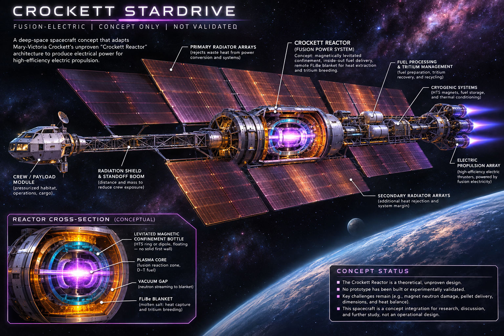

# Crockett Stardrive - Fusion-Electric Spacecraft Concept

> **Version 0.1 | Concept study only | Not built, simulated, validated, or flight-ready**
>
> Original Crockett Reactor architecture: **Mary-Victoria Crockett**. This spacecraft adaptation is an exploratory systems concept prepared at her direction, with AI assistance, around her November 17, 2026 public reactor write-up. It is **not** a demonstrated fusion rocket.

*AI-generated concept illustration, not CAD. The pictured crew-like compartment is artistic only; v0.1 assumes an uncrewed payload / science vehicle.*

## The core proposal

Use the **Crockett Reactor**'s proposed levitated high-temperature superconducting (HTS) dipole, timed central pellet fueling, and displaced FLiBe blanket as a hypothetical **electricity source** aboard an in-space vehicle. Convert recoverable heat to electric power, distribute that power to a **separate electric thruster cluster**, and reject the unused heat through expansive space radiators. This is an **integration hypothesis**, not a reactor performance prediction.

The terrestrial reactor write-up is already available in [`fusion/`](../README.md); the rocket study does not alter its original claims or its [31 enumerated open questions](../OPEN-QUESTIONS.md).

## Why fusion-electric first?

- A deuterium-tritium fusion reaction releases most of its energy in **neutrons**, which are not directly steered by a magnetic nozzle. The reactor source describes about **80% neutron energy / 20% charged-alpha energy**, and a FLiBe blanket intended to intercept neutron energy.
- **Electric thrusters require their own reaction mass.** This rocket does *not* assume that a levitated confinement plasma automatically produces a directed exhaust.
- A speculative **direct-fusion / fusion-thermal** option remains a trade-study branch, not the baseline, pending validated charged-particle extraction and exhaust-coupling analysis.

## View the concept

- [Illustrated one-page concept view](index.html) - static HTML, no scripts, works locally
- [Spacecraft side-profile SVG](diagrams/stardrive-side-profile.svg)
- [Power and thrust interface SVG](diagrams/power-and-thrust-flow.svg)
- [Reactor-spacecraft integration cutaway SVG](diagrams/reactor-module-cutaway.svg)
- [Architecture and assumptions](docs/architecture.md)
- [System trade study](docs/propulsion-trade-study.md)
- [Energy accounting and thermal gate](docs/energy-accounting.md)
- [Requirements and unresolved questions](docs/open-questions-and-test-plan.md)
- [Technical concept brief](docs/concept-brief.md)
- [References and provenance](docs/references-and-provenance.md)
- [Source-to-spacecraft technical crosswalk](docs/source-crosswalk.md)
- [Attribution and licensing](ATTRIBUTION-AND-LICENSE.md)
- [Release review checklist](docs/release-checklist.md)
- [Simple algebraic checks (illustrative, not a simulator)](models/sanity_checks.py)

## Major unresolved gates

1. **Physics:** sustained net-useful fusion-energy production has not been demonstrated for this architecture; the source's Q > 10 is a hypothesis.
2. **Geometry:** the nested chamber / spherical blanket / dipole dimensions currently **do not close**. The reactor's injection path also crosses structures with no defined access mechanism.
3. **Magnet lifetime:** a vacuum gap does not shield the levitated magnet from energetic neutrons.
4. **Power path:** the source shows ~400 MW to the blanket at its speculative 500 MWth plant scale, but its gross-electric projection applies conversion to 500 MW; the missing alpha-energy recovery path is unresolved.
5. **Spaceflight:** radiator surface, power-system mass, shadow shielding, cryogenics, fuel handling, thrust-to-weight, and mission trajectory **are unsized**.

**Do not quote the terrestrial write-up's 500 MWth, 186 MWe, or 47% cycle figures as spaceship performance.** Those are original author projections for a *ground pilot plant*, not measured, not validated, and not yet transferred to a spacecraft design.

## Status and contribution style

This research package is a **first-pass architecture**, intended to attract critical calculations and falsifiable reviews. Diagrams are **not to scale**; line placement does not establish mechanical clearance. Issues and pull requests should state assumptions, source every physical input, quantify uncertainties, and permit correction. Negative results count as useful results.

**Safety:** No radioactive material, reactor operation, fuel-processing procedure, or hardware build guidance is provided. No mission performance, readiness, or regulatory approval is asserted.

**License convention:** Refer to the parent project's [`LICENSE.md`](../../LICENSE.md). Documentation and diagrams are intended for CC BY-SA 4.0; executable code for GPL-3.0-or-later. AI-generated artwork has a separate rights/provenance notice. See [attribution and licensing notice](ATTRIBUTION-AND-LICENSE.md), and the [release review checklist](docs/release-checklist.md) before a public push, especially for AI-generated artwork.
